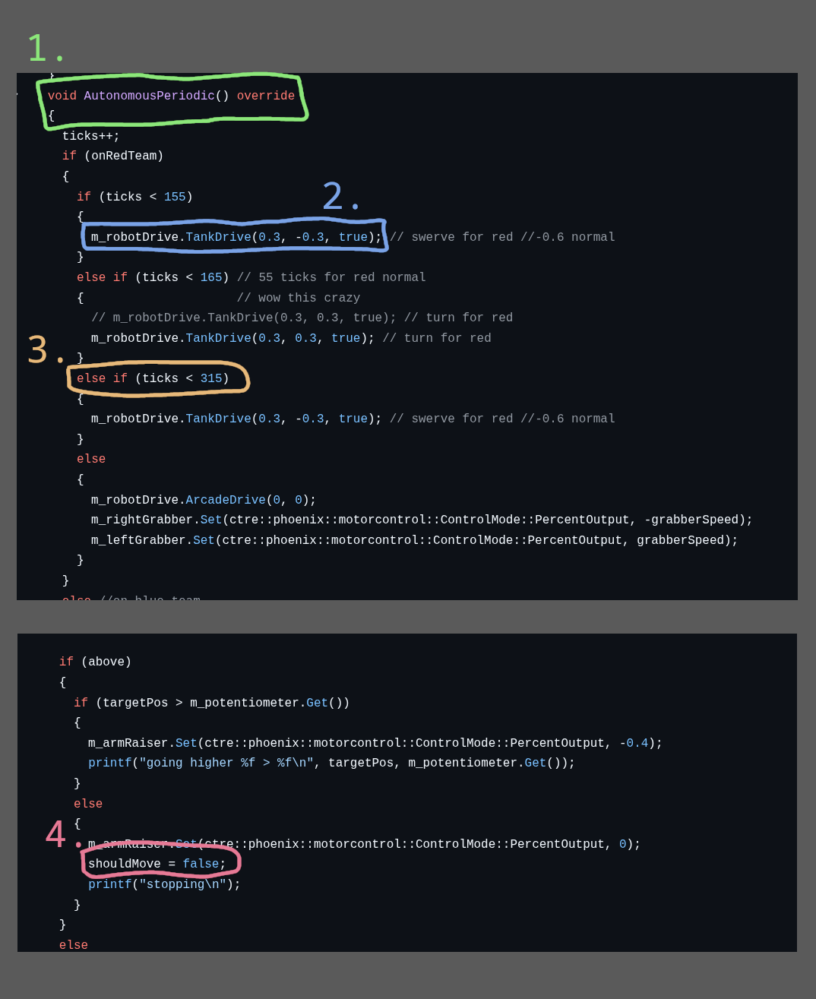
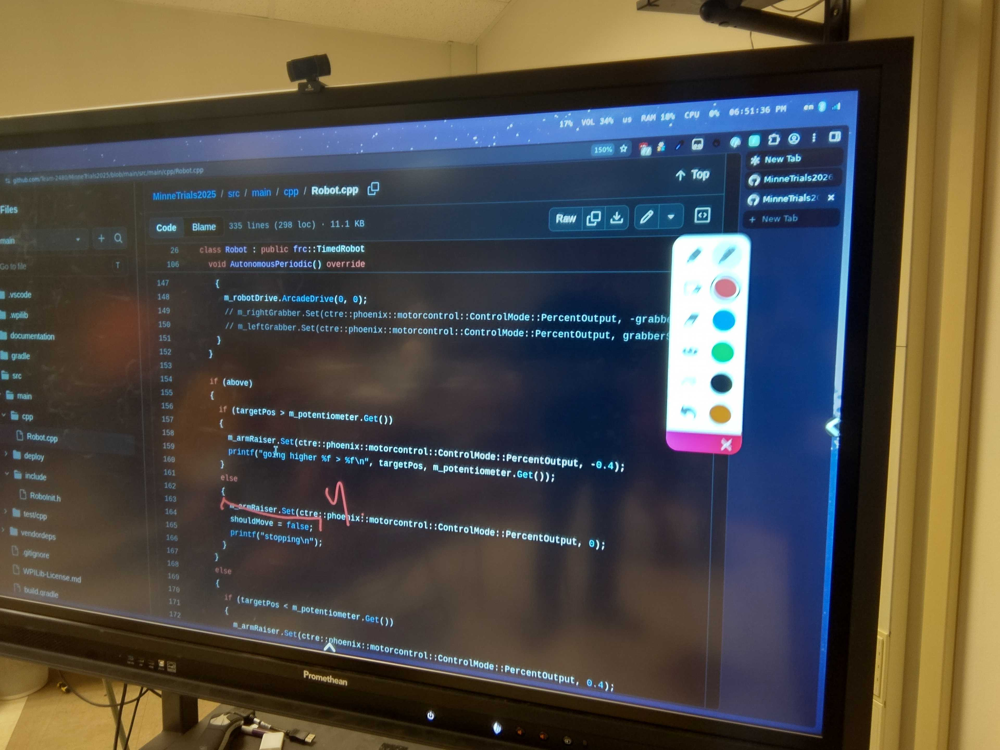
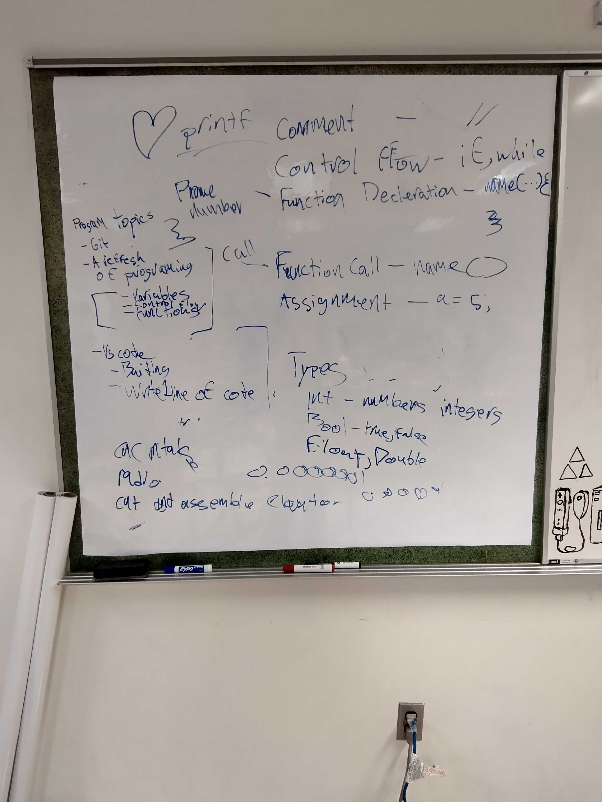
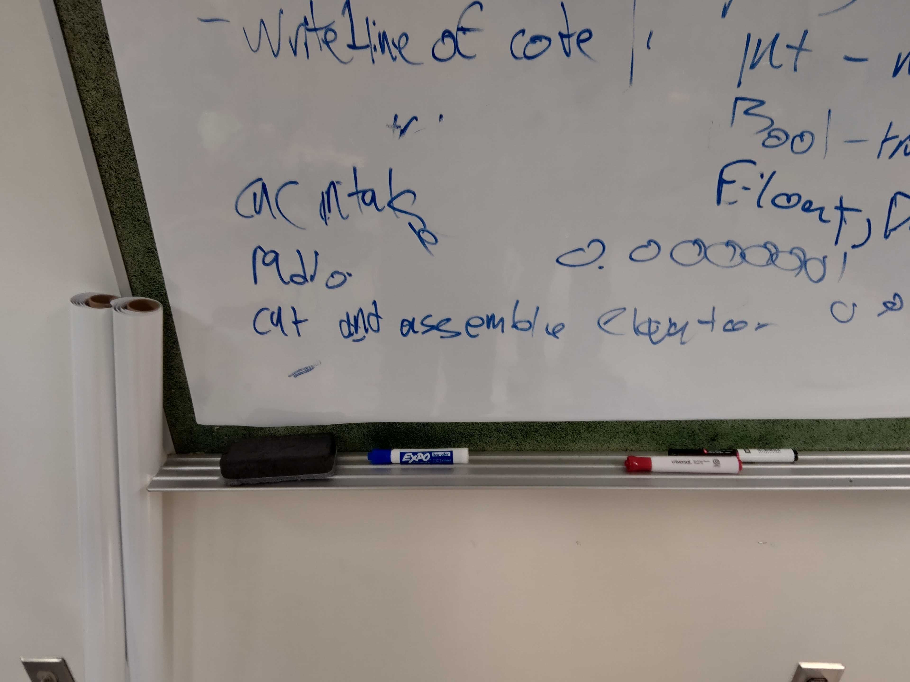
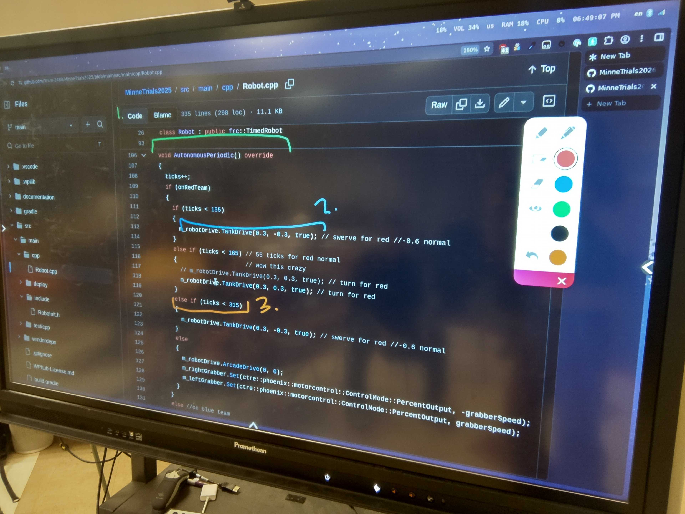

## Table of contents

- [2026-10-22](#2026-10-22)
   * [Areas Covered](#areas-covered)
   * [Homework](#homework)
   * [C++ Structures](#c-structures)
      + [Comment              ](#comment)
      + [Control Flow](#control-flow)
      + [Function Declaration / Definition](#function-declaration--definition)
      + [Function Call](#function-call)
      + [Assignment](#assignment)
   * [Types](#types)
   * [Photos](#photos)

## 2026-10-22

### Areas Covered

- Git
- An introduction to C++
    - Comments
    - Control Flow
    - Function Declarations
    - Function Calls
    - Assignment
    - Types

### Homework
For each numbered highlight do two things
- Tell me what it is, "that's a function call"
- Make a guess about what it is, and or what it is doing



DM me your guesses :)

### C++ Structures

#### Comment              
```c++
// this is a comment
```

#### Control Flow

```c++
if(condition) {

}
```

#### Function Declaration / Definition

The phone number

```c++
int name(bool argument) {

}
```

#### Function Call

The phone call

```c++
name(argument)
```

#### Assignment

```c++
variable = 0;
```

### Types

| Type           | Storage                                                                           |
| -------------- | --------------                                                                    |
| `int`          | A number, an **int**eger. Not a fraction.                                         |
| `bool`         | A **bool**ean. `true` or `false`                                                  |
| `float`        | A single-precision **float**ing point number. Can store like 0.5, 125.02, etc.... |
| `double`       | A **double**-precision floating point number. Just a more precise float.          |

### Photos






