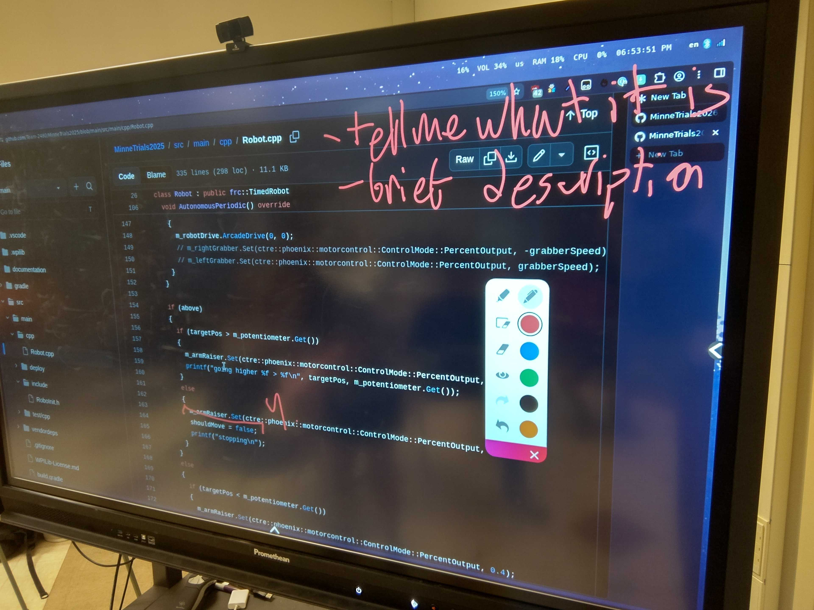

<!-- TOC start (generated with https://github.com/derlin/bitdowntoc) -->

- [Notes 2026-10-27](#notes-2026-10-27)
   * [Areas Covered](#areas-covered)
   * [Operations](#operations)
   * [Variable Assignment versus Variable Declaration](#variable-assignment-versus-variable-declaration)
   * [Life cycle of an FRC match](#life-cycle-of-an-frc-match)
- [Notes 2026-10-22](#notes-2026-10-22)
   * [Areas Covered](#areas-covered-1)
   * [C++ Structures](#c-structures)
      + [Comment              ](#comment)
      + [Control Flow](#control-flow)
      + [Function Declaration / Definition](#function-declaration--definition)
      + [Function Call](#function-call)
      + [Assignment](#assignment)
   * [Types](#types)
- [Homework 2026-10-22](#homework-2026-10-22)
   * [Bonus Photos](#bonus-photos)

<!-- TOC end -->
## Notes 2026-10-27

### Areas Covered

- Review homework
- Operations
- Variable Assignment versus Variable Declaration
- Lifetime of an FRC match

### Operations


These will do math
| Symbol         | Operation       |
| -------------- | --------------- |
| `+`            | add             |
| `-`            | subtract        |
| `*`            | multiply        |
| `/`            | divide          |
| `()`           | parenthesis     |

These will reassign the variable
| Symbol         | Operation       |
| -------------- | --------------- |
| `+=`           | plus equals     |
| `-=`           | minus equals    |
| `*=`           | multiply equals |
| `/=`           | divide equals   |
| `++`           | increment       |
| `--`           | decrement       |

These will turn `int`s into `bool`s
| Symbol         | Operation       |
| -------------- | --------------- |
| `>`            | greater than    |
| `<`            | less than       |
| `==`           | equivalent to   |

Math works like you would expect, order of operations still applies.

```c++
int score;
score = ((5 * 5) + 3) / 2 - 3 + 5
// score is 16
```


```c++
score = score + 1;
// is the same as
score += 1;
// is the same as
score++;

score = score - 1;
// is the same as
score -= 1;
// is the same as
score--;
```

### Variable Assignment versus Variable Declaration

Assignment:
```
score = 5;
```

Declaration:
```
int score;
```

A declaration then an assignment:
```
int score = 5;
```

### Life cycle of an FRC match

1. The Soup, things that are not in functions.
1. FRC runs the AutonomousInit function once.
1. FRC runs the AutonomousPeriodic function periodically.
1. FRC runs the TeleopInit function once.
1. FRC runs the TeleopPeriodic function periodically.

When testing via the DS (Drive Station) program we can start either at
autonomous or teleop.

Teleop is short for teleoperation, controlling something at a distance ie. a
controller.

## Notes 2026-10-22

### Areas Covered

- Git
- An introduction to C++
    - Comments
    - Control Flow
    - Function Declarations
    - Function Calls
    - Assignment
    - Types

### C++ Structures

#### Comment              
```c++
// this is a comment
```

#### Control Flow

```c++
if(condition) {

}
```

#### Function Declaration / Definition

The phone number

```c++
int name(bool argument) {

}
```

#### Function Call

The phone call

```c++
name(argument)
```

#### Assignment

```c++
variable = 0;
```

### Types

| Type           | Storage                                                                           |
| -------------- | --------------                                                                    |
| `int`          | A number, an **int**eger. Not a fraction.                                         |
| `bool`         | A **bool**ean. `true` or `false`                                                  |
| `float`        | A single-precision **float**ing point number. Can store like 0.5, 125.02, etc.... |
| `double`       | A **double**-precision floating point number. Just a more precise float.          |


---------------------

## Homework 2026-10-22

For each numbered highlight do two things
- Tell me what it is, ie "that's a function call"
- Make a guess about what it is, and or what it is doing


DM me your guesses :)

### Bonus Photos





